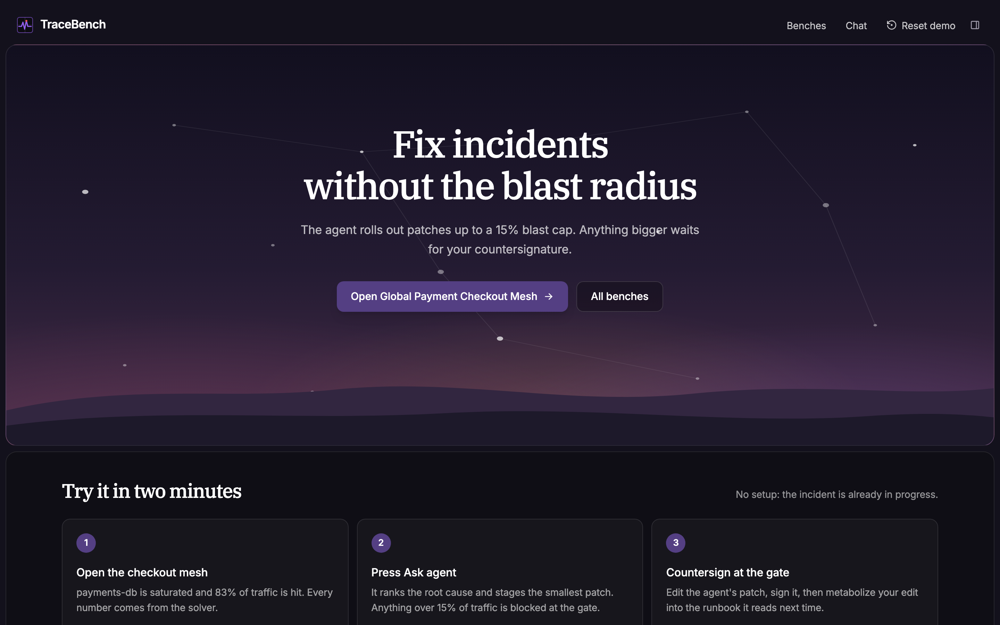
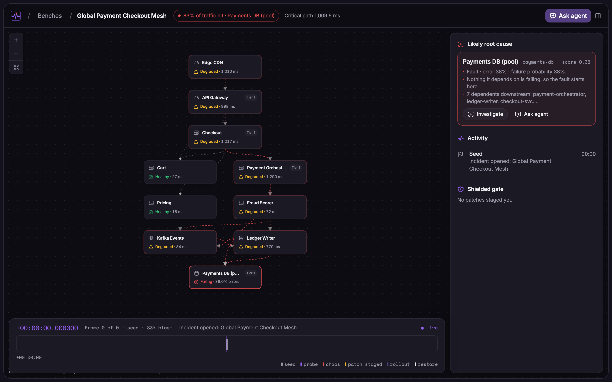
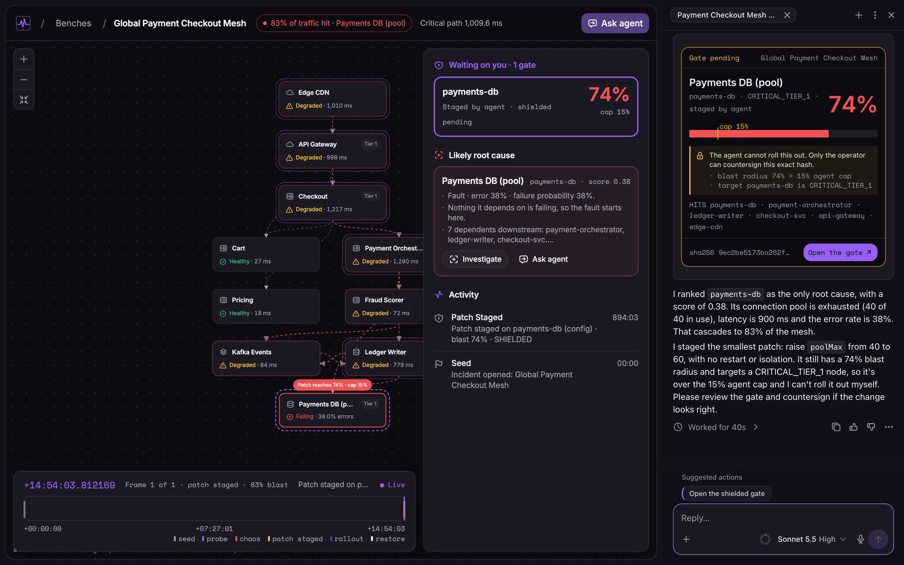
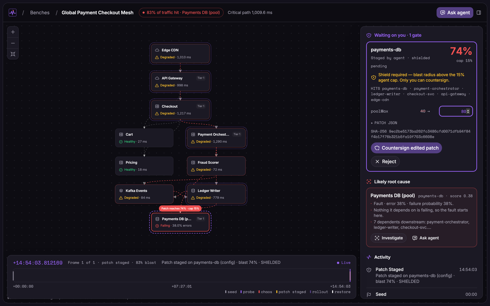
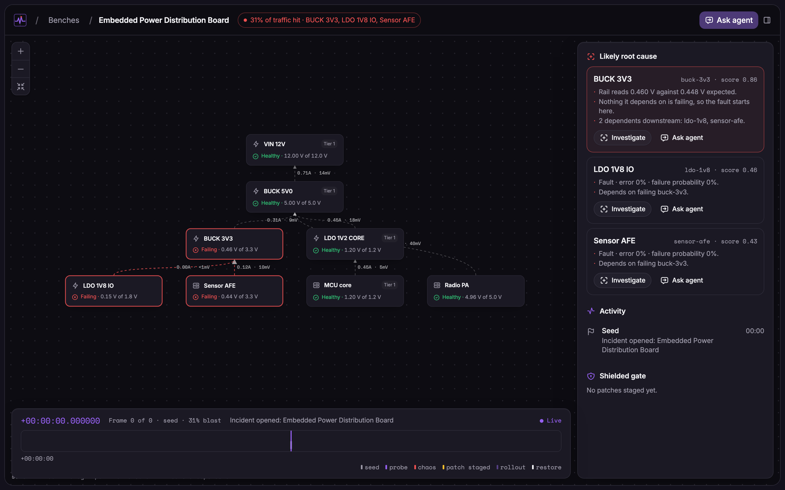

```
TRACEBENCH  ·  fault isolation · 15% blast-radius gate · µs incident replay
───────────────────────────────────────────────────────────────────────────
```

**Live Incident Drill (Clips):** https://clips.agent-native.com/share/5AOgPKI7Q5vQ · **Repeatability & Drill Transcript:** [assets/outage-drill-log.md](assets/outage-drill-log.md)

```bash
npm install
npx agent-native dev        # starts on http://localhost:5173/bench
npm test                    # 56 solver, property, gate, and runbook tests
npm run typecheck
npx agent-native doctor
```

TraceBench is an interactive topology fault-isolation workbench and blast-radius gate built with [`@agent-native/core`](https://www.agent-native.com). A deterministic graph and nodal solver computes cascading failure probabilities, Tarjan strongly connected components, and PCB `I·R` voltage drop across live topologies. The incident agent can autonomously roll out low-impact mitigations (`≤ 15%` traffic blast radius on non-tier-1 nodes), while high-blast patches are intercepted by a cryptographic human countersignature gate.

---

## 1. Execution Pipeline & Scoped Autonomy

On-call SREs and hardware bring-up engineers need a mathematically enforced boundary between patches an AI agent may ship on its own and patches that require human authorization. TraceBench computes that boundary directly from the dependency graph:

```
probe / fault ──► graph_nodes ──► solver ──► incident_frames ──► µs scrubber
                                    │
agent ──► stage-patch ──► blast % + sha256 ──► ShieldedGate ──► operator countersign
```

### Deterministic Solver Formulations (`app/lib/solver/`)

```text
[1] Cycle Decomposition   Iterative Tarjan SCC; feedback loops (ledger-writer ⇄ kafka-events)
                          converge via fixed-point iteration.
[2] Cascading Latency     L_eff(u) = L_base(u) + Σ w_uv · L_eff(v)  (topological order)
[3] Failure Propagation   P(u) = 1 − (1 − p_u) · Π (1 − w_uv · P(v))
[4] DC Power Nodal Solver Upstream load current summation & downstream voltage drop
                          (ΔV = I·R, P = I²R), buck efficiency, LDO dropout, and
                          foldback current limiting on short circuits.
[5] Blast Radius (%)      Weighted traffic share of all upstream dependents reachable from
                          the faulted or patched node (coupling threshold 0.35 for config edits).
```

### Cryptographic `ShieldedGate` (`actions/authorize-rollout.ts` & `server/incident/gate.ts`)

- **`stage-patch`:** Evaluates the candidate patch against the solver, computes its exact downstream blast radius, and hashes its canonical JSON payload with SHA-256.
- **Autonomous vs. Shielded Boundary:** Any patch whose blast radius exceeds the topology's autonomous cap (**15%**) or targets a `CRITICAL_TIER_1` node opens a gate in `SHIELDED_PENDING`.
- **Caller-Verified Countersignature (`409 BLAST_RADIUS_CAP_EXCEEDED`):** `authorize-rollout` rejects any invocation lacking a matching SHA-256 `patchDiffHash` **and** a countersignature from a signed-in operator in the app UI. Agents invoking `authorize-rollout` over tool calls, CLI, MCP, or A2A with `humanCountersigned: true` are rejected; patches under the cap still roll out autonomously.
- **Closed-Loop Runbook Bounds (`metabolize-runbook` & `server/incident/runbook-bounds.ts`):** When an operator edits the agent's staged JSON inside the `ShieldedGate` drawer before signing, the browser re-hashes the modified payload and `metabolize-runbook` writes the structured unified diff into `runbook_rules` and `.agents/skills/incident-runbooks/SKILL.md`. Later agent patches on the same node and kind are bounded by it in `stage-patch`: any value the operator raised or lowered is moved to the operator's value and returned as `runbookAdjustments`.

---

## 2. Seeded Benches & Visual Telemetry



### Bench A — Global Payment Checkout Mesh (`distributed_infra` · `83%` Initial Blast)

Telemetry strip reads `BLAST 83% · FAULTS payments-db · CRIT PATH 1009.6ms · SCC ledger-writer⇄kafka-events`.



When the operator clicks **Ask agent**, the agent reads `<current-screen>`, ranks `payments-db` (`0.38`) as root cause, and stages `poolMax: 40 → 60`. The gate blocks autonomous rollout at **74% blast** (`CRITICAL_TIER_1`):



Opening the **Shielded Gate** drawer lets the operator raise `poolMax` from `60` to `80` before clicking **Countersign**—recomputing the SHA-256 digest, collapsing blast radius to **`0%`**, and metabolizing `poolMax: 60 → 80` into the runbook:



### Bench B — Embedded Power Distribution Board (`hardware_pcb` · `31%` Initial Blast)

Models an 8-node DC power tree where a `0.15 Ω` short on `BUCK 3V3` triggers foldback current limiting and collapses the rail to `0.448 V`:



---

## 3. Seven-Step Outage Drill (`http://localhost:5173/bench`)

- **`[01]` Open `/bench`:** Displays both seeded topologies: **Global Payment Checkout Mesh** (`83%` blast) and **Embedded Power Distribution Board** (`31%` blast).
- **`[02]` Launch Global Payment Checkout Mesh:** Inspect `BLAST 83% · FAULTS payments-db · CRIT PATH 1009.6ms · SCC ledger-writer⇄kafka-events`.
- **`[03]` Click `Ask agent`:** Agent inspects `<current-screen>`, ranks `payments-db` (`0.38`) as root cause, and stages `poolMax: 40 → 60`, which enters `SHIELDED_PENDING` at **74% blast** (`CRITICAL_TIER_1`).
- **`[04]` Edit & Countersign in `ShieldedGate`:** Change `poolMax` to `80` and click **Countersign**; the browser recomputes SHA-256, rollout executes, and all nodes recover to **`0%`** blast.
- **`[05]` Click `Metabolize into runbook`:** Persists the `poolMax: 60 → 80` operator delta into `.agents/skills/incident-runbooks/SKILL.md` and `runbook_rules`.
- **`[06]` Click `Reset demo → Reset, keep learned rules` (`reinit-benches`), then `Ask agent`:** `stage-patch` bounds the agent's draft with the metabolized rule so the gate opens directly at `poolMax: 80` (`runbook poolMax 60→80`).
- **`[07]` Scrub the `µs` Temporal Scrubber or switch to `Embedded Power Distribution Board`:** Replay historical solver frames with *Restore as live*, or inspect the `0.15 Ω` short on `BUCK 3V3` (`0.448 V`).

Full transcripts and 5-run repeatability metrics are recorded in [assets/outage-drill-log.md](assets/outage-drill-log.md).

---

## 4. Verification Matrix & Production Environment

56 unit and property tests (`app/lib/solver/{solver,properties}.test.ts`, `app/modules/schematic/layout.test.ts`, and `server/incident/{gate,patch-diff,runbook-bounds}.test.ts`) verify:

- Tarjan SCC cycle detection and fixed-point convergence against hand-calculated reference values.
- Structural solver invariants across randomized directed graphs (partition completeness, topological ordering, blast monotonicity, link-cut isolation).
- DC nodal power analysis (`I·R` drop, `I²R` dissipation, LDO dropout, current-limit foldback).
- Deterministic schematic layout coordinates (`0` node-box overlaps across both seeded topologies).
- Cryptographic `ShieldedGate` enforcement (autonomous pass `≤ 15%`, `409 BLAST_RADIUS_CAP_EXCEEDED` above cap or on `CRITICAL_TIER_1`, tampered SHA-256 rejection, and rejection of non-UI agent/CLI/MCP callers claiming `humanCountersigned: true`).
- Unified diff extraction and operator runbook bound enforcement (`applyLearnedRunbookBounds`) for metabolized operator edits.

For standalone production deployments, set `DATABASE_URL` (PostgreSQL connection string) and `BETTER_AUTH_SECRET` (`openssl rand -hex 32`), then run `npm run build`.
