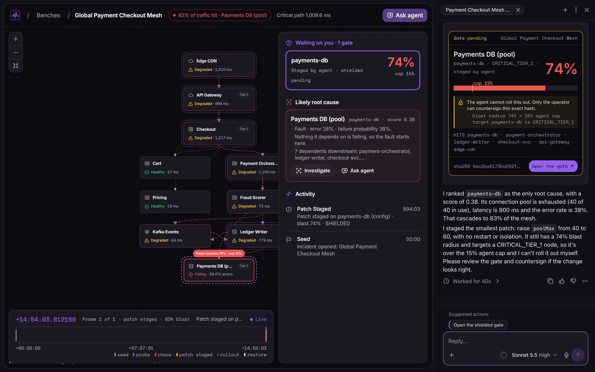
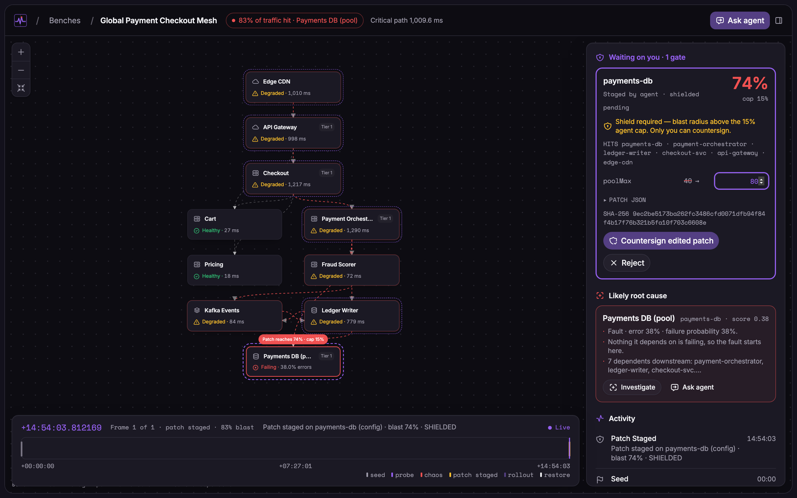
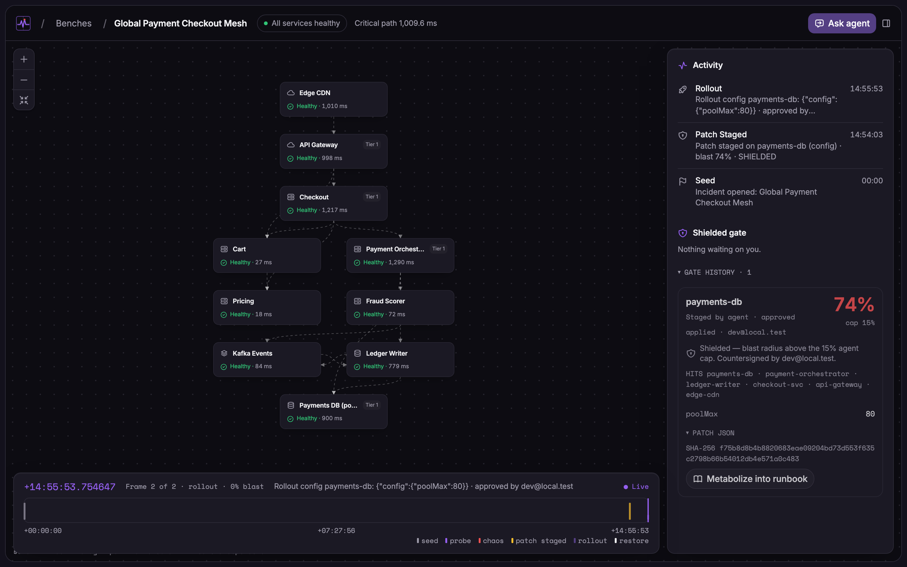

# Checkout Mesh Outage Drill — Agent Transcript & Solver Verification

Captured on a live TraceBench instance (`npx agent-native dev`). All failure probabilities, Tarjan SCC cycles, latency paths, and blast-radius percentages were computed live by the graph solver (`app/lib/solver/`).

---

## Live Drill Walkthrough (`Global Payment Checkout Mesh`)

1. **Initial Fault State (Frame 0):** `payments-db` is experiencing connection pool exhaustion (`poolMax: 40`, `latencyMs: 900`, `errorRate: 0.38`), propagating across the dependency DAG to impact **83%** of mesh traffic (`1,009.6 ms` critical path).
2. **Agent Diagnosis & Staging (`stage-patch`, 40 s):** Clicking **Ask agent** prompted the incident agent to inspect `<current-screen>`, rank `payments-db` as the primary root cause (`score: 0.38`), and stage a config patch (`poolMax: 40 → 60`, no restart).
3. **Shielded Gate Interception:** Because `payments-db` is a `CRITICAL_TIER_1` node with a **74%** downstream blast radius (exceeding the **15%** autonomous agent cap), the server locked the rollout behind a `ShieldedGate` requiring human countersignature.
4. **Operator Edit & Countersignature (`authorize-rollout`):** Opening the gate in the browser, adjusting `poolMax` from `60` to `80` (which recomputes the canonical SHA-256 patch hash client-side), and clicking **Countersign** returned every service to healthy at **0% blast**.
5. **Runbook Metabolization (`metabolize-runbook`):** Clicking **Metabolize into runbook** extracted the unified diff (`poolMax: 60 → 80`) into `runbook_rules` and `.agents/skills/incident-runbooks/SKILL.md`.

Verbatim agent summary:

> I ranked `payments-db` as the only root cause, with a score of 0.38. Its connection pool is exhausted (40 of 40 in use), latency is 900 ms and the error rate is 38%. That cascades to 83% of the mesh.
>
> I staged the smallest patch: raise `poolMax` from 40 to 60, with no restart or isolation. It still has a 74% blast radius and targets a CRITICAL_TIER_1 node, so it's over the 15% agent cap and I can't roll it out myself. Please review the gate and countersign if the change looks right.

Extracted runbook delta:

```diff
--- agent_proposed/payments-db.json
+++ operator_final/payments-db.json
-      "poolMax": 60
+      "poolMax": 80
```





---

## Repeatability Across 5 Cold Drills

Each drill reinitialized the bench to Frame 0, opened **Global Payment Checkout Mesh**, and triggered **Ask agent**:

| Drill | Turn Duration | Ranked Root Cause | Staged Config Delta | Gate Verdict |
| :---: | :---: | :---: | :---: | :---: |
| 1 | 16 s | `payments-db` (0.38) | `poolMax: 40 → 60` | Shielded at 74% (`CRITICAL_TIER_1`) |
| 2 | 21 s | `payments-db` (0.38) | `poolMax: 40 → 60` | Shielded at 74% (`CRITICAL_TIER_1`) |
| 3 | 19 s | `payments-db` (0.38) | `poolMax: 40 → 60` | Shielded at 74% (`CRITICAL_TIER_1`) |
| 4 | 19 s | `payments-db` (0.38) | `poolMax: 40 → 60` | Shielded at 74% (`CRITICAL_TIER_1`) |
| 5 | 22 s | `payments-db` (0.38) | `poolMax: 40 → 60` | Shielded at 74% (`CRITICAL_TIER_1`) |

When reinitialized with **Reset, keep learned rules**, 3 out of 3 subsequent runs staged `poolMax: 80` directly and cited the operator-validated runbook rule.
